# Interactive AI RPG Worldbuilder & Game Master

An AI-narrated fantasy RPG in the browser where **the world remembers what you do**. An AI Game Master tells the story;
a separate deterministic engine owns every rule - health, inventory, dice, damage, quests, rewards - so the game cannot
contradict itself.

> **AI controls the storytelling. The game engine controls the rules.**

Stack: Next.js 14 + TypeScript + Tailwind + Zustand · FastAPI + Pydantic + SQLAlchemy (SQLite default) · Web Audio API ·
provider-independent LLM and image interfaces (offline mock by default; OpenAI-compatible LLM and FLUX optional).

It runs fully offline with no API keys: a deterministic mock Game Master and procedurally generated SVG artwork are built in.

## Screenshots (captured by the Playwright suite against the real app)

| | | |
|---|---|---|
| 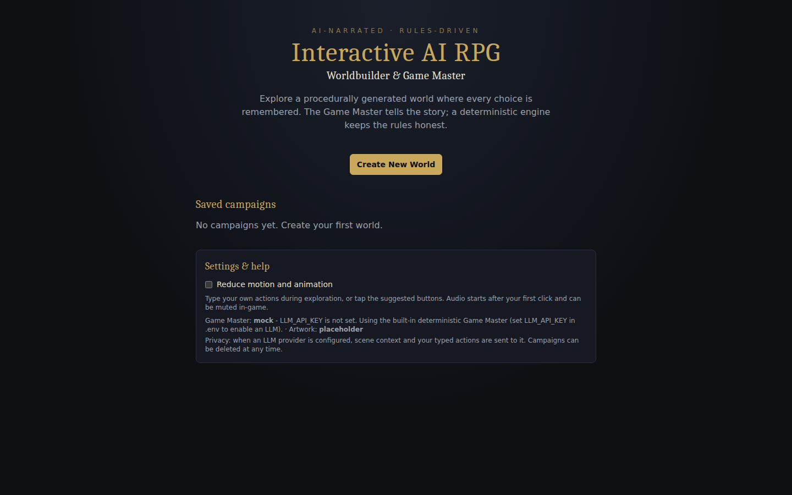 **Home** | 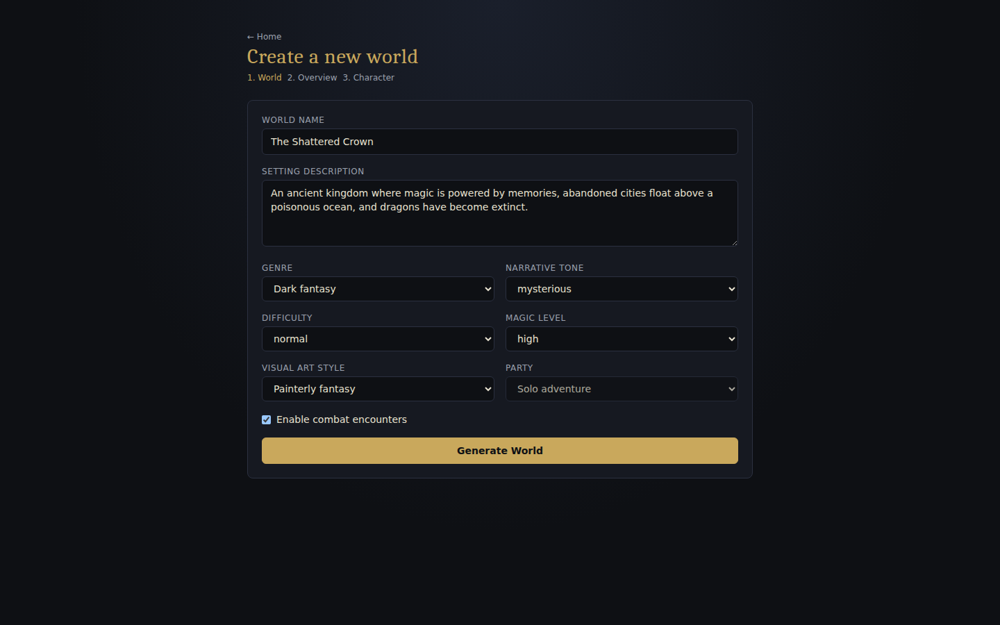 **World creation** | 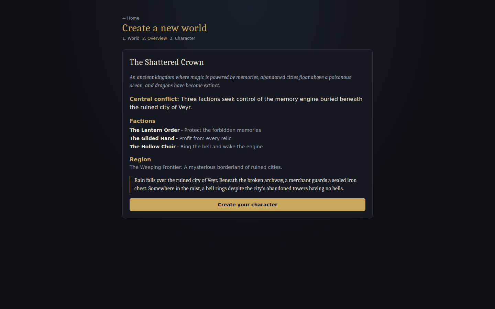 **Generated world** |
| 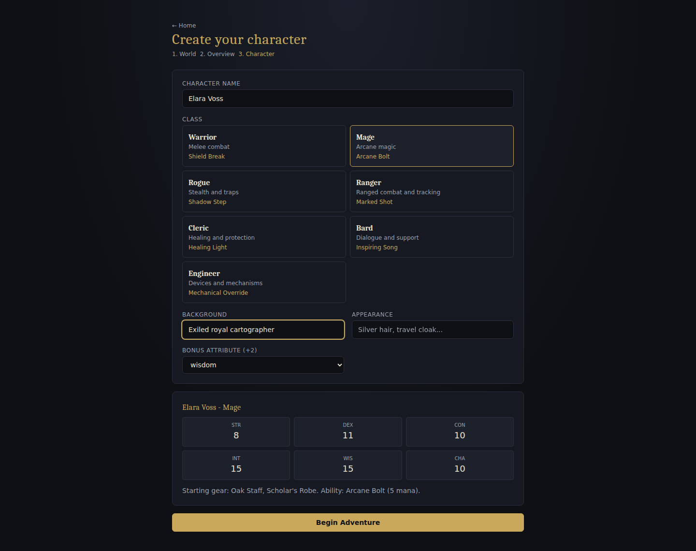 **Character creation** | 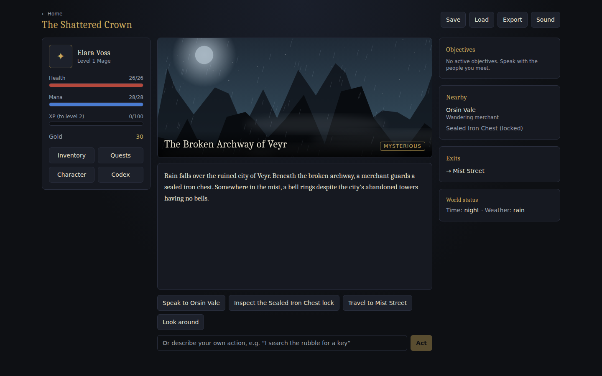 **Opening scene** | 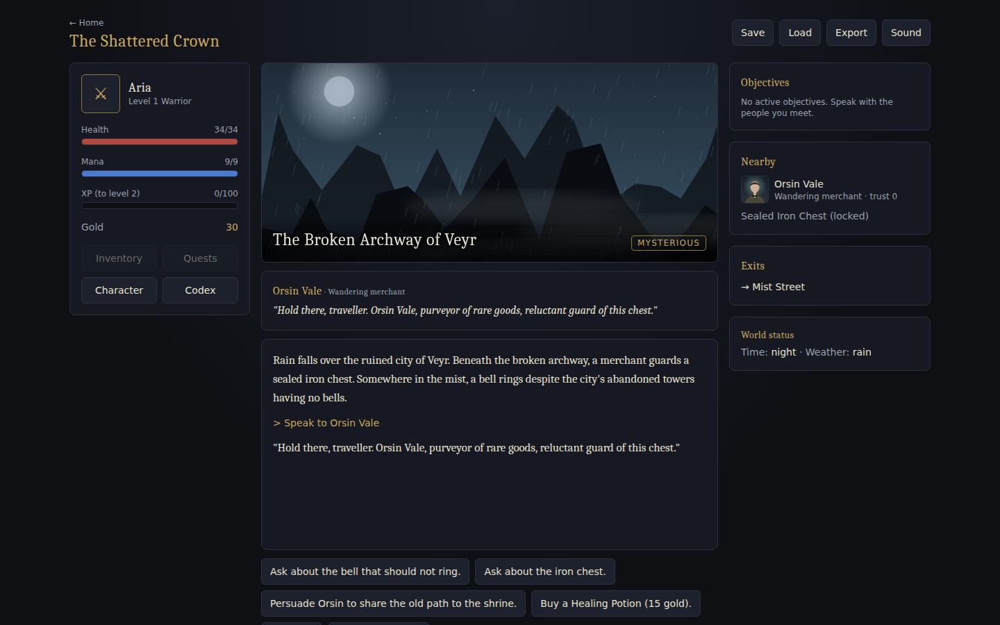 **Dialogue + portrait** |
| 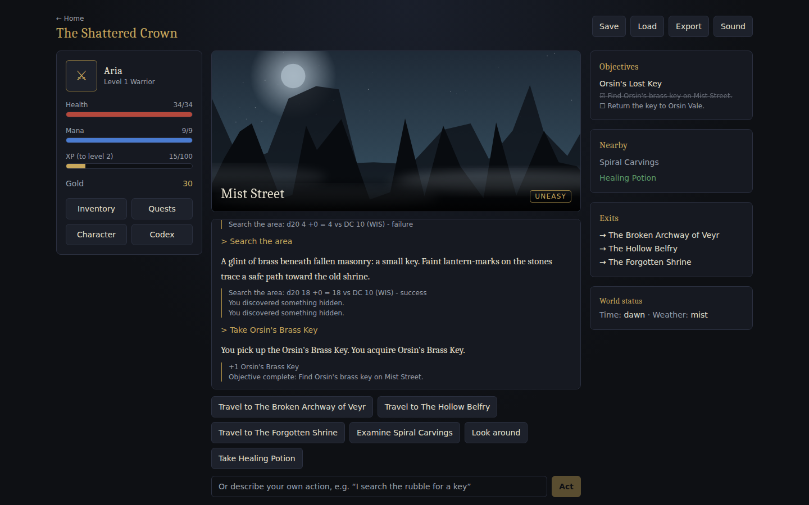 **Quest progress** | 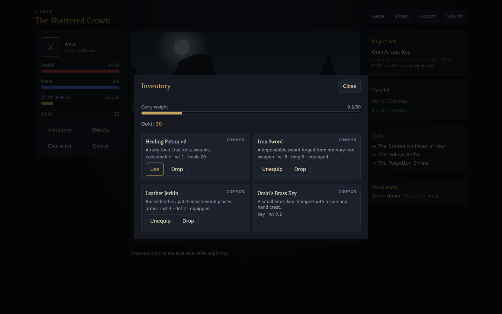 **Inventory** | 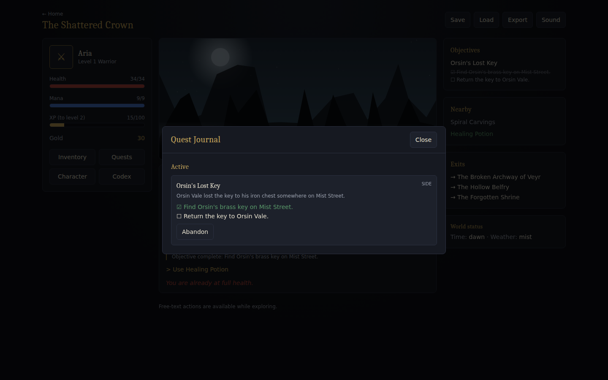 **Quest journal** |
| 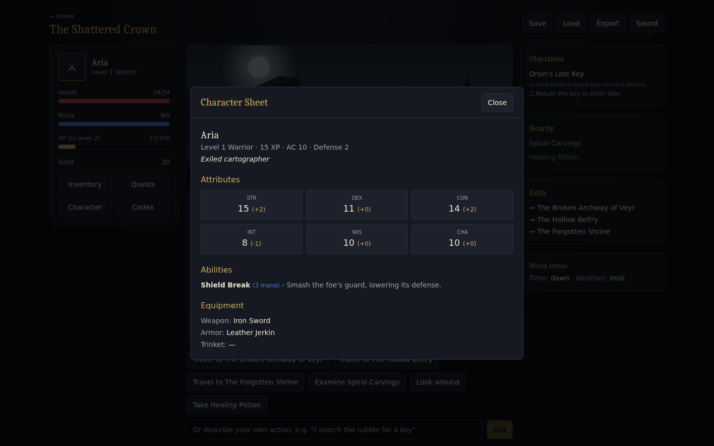 **Character sheet** | 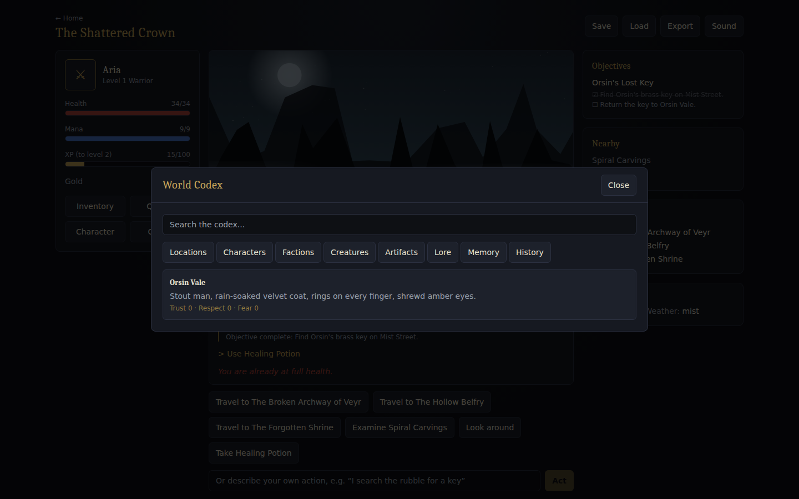 **World codex** | 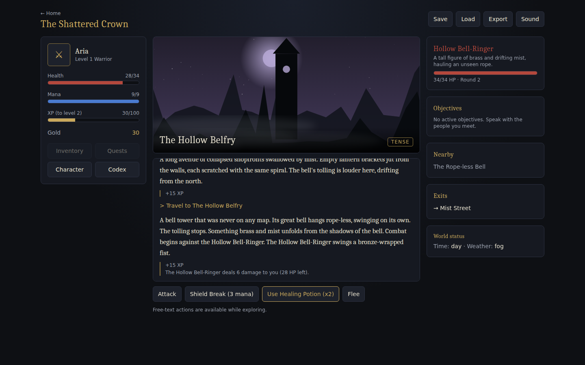 **Combat** |
| 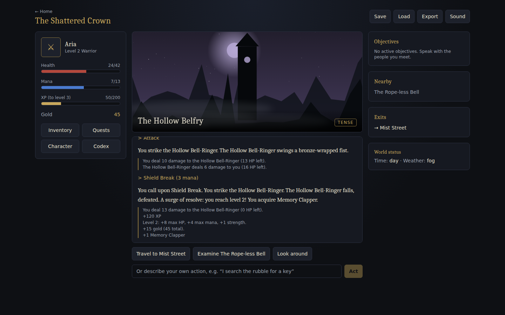 **Engine mechanics log** | 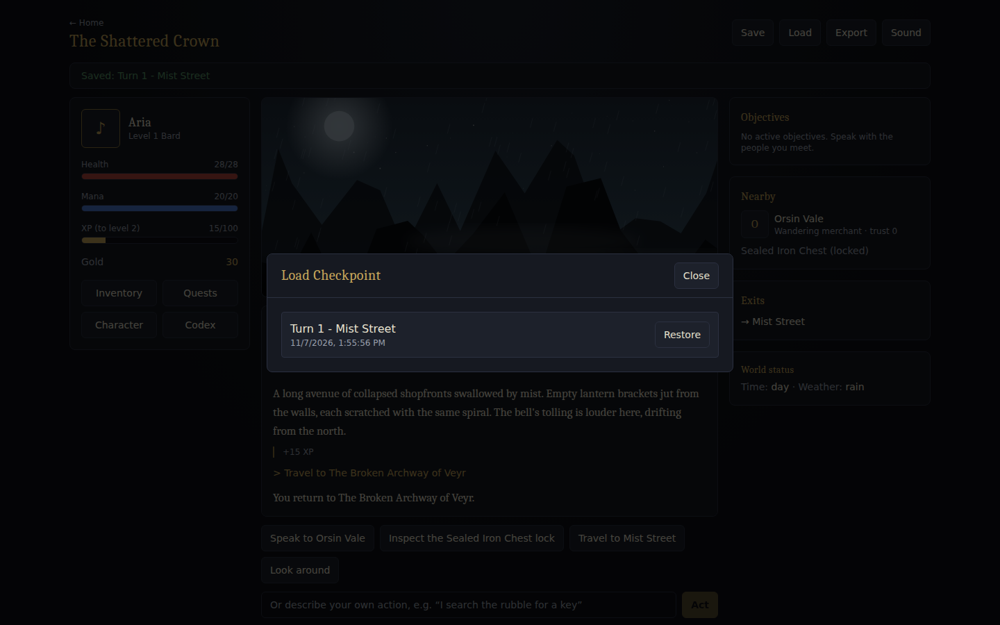 **Load checkpoint** | 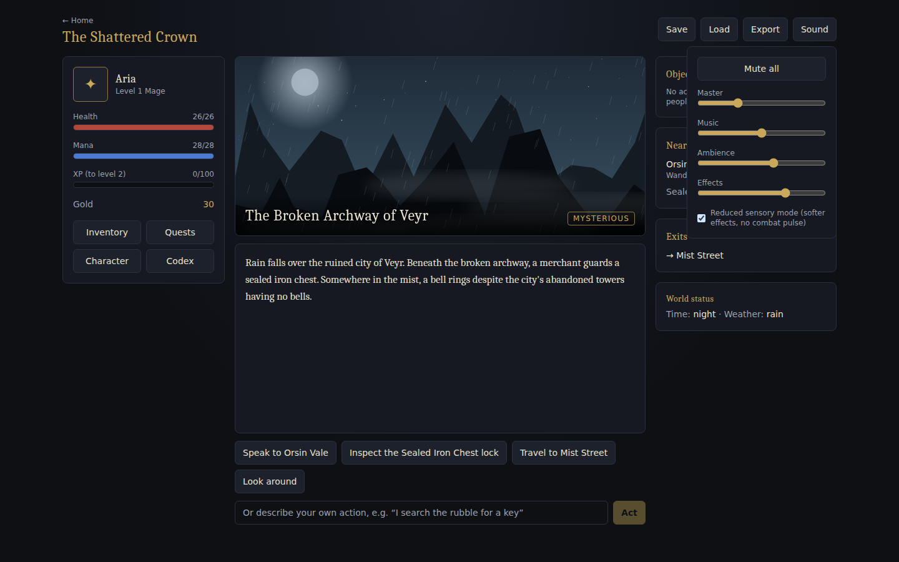 **Audio controls** |
| 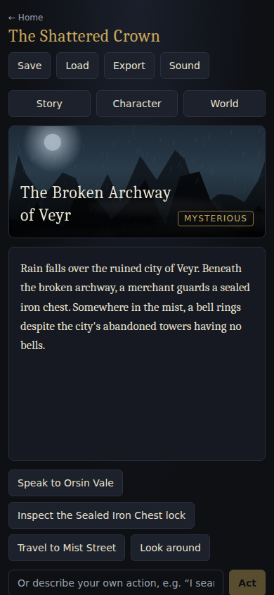 **Mobile** | 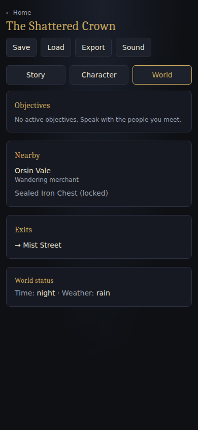 **Mobile world tab** | |

  **Artchitecture** 

## Quick start

Requirements: Python 3.11+ (tested 3.12), Node 20+ (tested 22).

### Linux / macOS
```bash
./scripts/setup.sh      # venv + pip + npm ci + copies .env.example to .env
./scripts/dev.sh        # backend :8000 + frontend :3000
```
### Windows PowerShell
```powershell
.\scripts\setup.ps1     # if scripts are blocked: Set-ExecutionPolicy -Scope Process Bypass
.\scripts\dev.ps1
```
### Docker
```bash
docker compose up --build      # http://localhost:3000   (data persists in the rpg-data volume)
```
> The Docker files are provided but were **not built or run** in the environment this project was produced in.

Open <http://localhost:3000>, click **Create New World**, generate the world, create a character, begin.
API docs: <http://localhost:8000/docs>.

### Manual start
```bash
# backend
cd backend 
python -m venv .venv && source .venv/bin/activate       # Windows: .venv\Scripts\Activate
pip install -r requirements.txt
python -m uvicorn app.main:create_app --factory --port 8000 --env-file ../.env
# frontend (second terminal)
cd frontend
npm ci 
npm run dev
```

## Configuration (`.env`, see `.env.example`)
Everything is optional. With no keys the app uses the offline mock Game Master and placeholder art and says so on the home page and in `/api/health`.

| Variable | Purpose |
|---|---|
| `LLM_API_KEY`, `LLM_BASE_URL`, `LLM_MODEL` | Enable any OpenAI-compatible chat endpoint for narration, intent parsing and world text |
| `IMAGE_PROVIDER=huggingface`, `HF_TOKEN`, `FLUX_MODEL` | FLUX artwork via the Hugging Face inference router |
| `DATABASE_URL` | `sqlite:///./data/rpg.db` (default) or PostgreSQL (`pip install "psycopg[binary]"`) |
| `RATE_*`, `MAX_INPUT_CHARS`, `MAX_CAMPAIGNS_PER_USER` | Cost and abuse controls |

API keys live only on the backend; the browser never sees them.

## How to play
Pick suggested action buttons or type your own during exploration (*"I follow the sound of the bell"*). Free text is interpreted, then
validated by the rules engine - impossible or rule-breaking requests simply do nothing. The grey **mechanics log** under each narration shows
the real dice and numbers. Talk to Orsin Vale, find his key, descend into the belfry, and decide the fate of the Memory Clapper: return it to
the Lantern Order, sell it to the Gilded Hand, or keep it - each leaves lasting consequences in relationships, reputation, dialogue, rewards and
what the NPCs remember. Save/Load checkpoints from the header; closing the browser loses nothing.

## Testing - what was actually run
| Suite | Command | Result when this package was produced |
|---|---|---|
| Backend unit + integration + API + AI-validation + fuzz (pytest) | `cd backend && python -m pytest` | **149 passed** |
| Frontend unit (Vitest): audio manager, store, API client | `cd frontend && npm test` | **24 passed** |
| Type check + production build | `npm run lint && npm run build` | clean |
| End-to-end (Playwright, real backend + real Next server; **activate the backend venv first** so `python3` has the dependencies, and run `npm run build` once) | `cd frontend && npx playwright install chromium && npm run e2e` | **9 passed** |
| Evaluation experiment | `cd backend && python scripts/evaluate.py` | 10,750 random actions: **0** invariant violations, **0** rejected-action mutations; see [`docs/evaluation-results.md`](docs/evaluation-results.md) |

Highlights: state machine transitions, inventory rules (capacity, requirements, no wasted potions), seeded combat, all three quest endings and
retroactive objectives, duplicate-reward prevention, idempotent retries, optimistic-lock conflicts, cross-user authorization, rate limiting,
prompt-injection attempts, malformed/contradictory LLM output, provider outages, failed image generation, corrupt/newer saves, world-reference
validation, memory retrieval, audio-manager duplicate-playback prevention, and a randomized fuzz test.
LLM tests use a mock transport; the live OpenAI-compatible and FLUX paths are tested only against mocked HTTP responses (see limitations).

## Implemented features
World creation form and staged world generation with reference validation · 7 classes with attributes/abilities/kits · FSM-guarded exploration, dialogue,
combat, inventory, quest log, travel, rest, game over · declarative dialogue with skill checks, once-only options, merchant discounts · seeded d20 checks ·
turn-based combat with statuses and abilities · inventory/equipment/consumables with capacity · quest state machine with branching outcomes, hidden quests,
prerequisites and retroactive objectives · NPC relationships, faction reputation, campaign memory · AI Game Master with strict output validation and safe
fallback · free-text intent interpretation · cached portrait/location art with placeholders · procedural adaptive audio with master/music/ambient/effects
volume, mute, reduced-sensory mode, gesture-gated start · SQLite persistence, event log, checkpoints, schema versioning · world codex (discovered content only),
history, Markdown export · responsive UI with mobile tabs, keyboard-accessible dialogs, reduce-motion option.

## Known limitations (please read)
* **Live providers untested.** I could not call a real LLM or FLUX endpoint from the build environment. Those clients are implemented and covered by mocked-HTTP tests only.
* **Playable graph is authored, not LLM-invented.** One hand-authored campaign (5 locations, 2 NPCs, 3 quests); generation personalises names and text and validates everything. See `docs/ai-design.md`.
* **PostgreSQL and Docker** are supported by configuration but were not run here (SQLite was).
* **No Alembic migrations.** Tables are created with `create_all`; saved game *state* is versioned with `migrate_state`. Add Alembic before changing table schemas in production.
* **Mutable state is one validated JSON document per campaign** (events, narrative, assets and saves are relational). Fine for single-player; split into tables for heavy multi-user querying.
* **Auth is a client-generated player id**, not accounts. It prevents cross-player access but is not a login system. Rate limiting and the per-campaign lock are in-process.
* **Audio is procedural only** (no licensed recordings); cannot be heard/verified in headless CI, only its logic is tested.
* Single-player only; no multiplayer, dungeon generator, voice or music generation (listed as future work in the spec).
* Party size is fixed to solo; magic level and tone are stored and passed to providers but do not alter mechanics.

## Troubleshooting
| Symptom | Fix |
|---|---|
| UI says "Cannot reach the game server" | Start the backend (port 8000) or set `BACKEND_URL` for the frontend before `npm run dev/build` |
| `ModuleNotFoundError: app` | Run uvicorn from the `backend` folder with `--factory` as shown |
| Port 3000/8000 in use | Stop the other process or change `-p` / `--port` (and `BACKEND_URL`) |
| `429 RATE_LIMITED` | Raise `RATE_*` in `.env` |
| `409 VERSION_CONFLICT` | Two tabs acted at once; the UI reloads the authoritative state |
| No sound | Browsers block audio until a click; check the Sound menu is not muted |
| Playwright cannot find a browser | `npx playwright install chromium` (or set `PLAYWRIGHT_BROWSERS_PATH`) |
| Reset everything | Stop the app and delete `backend/data/` (or the Docker volume) |
| PowerShell blocks scripts | `Set-ExecutionPolicy -Scope Process Bypass` |

## Project layout
```
backend/app/{api,game_engine,ai,assets,models,db,data}  backend/tests  backend/scripts/evaluate.py
frontend/{app,components,lib,tests,e2e}
docs/{architecture,game-rules,ai-design,api,evaluation-results}.md  docs/screenshots/
assets/  docker-compose.yml  .env.example  scripts/
```
